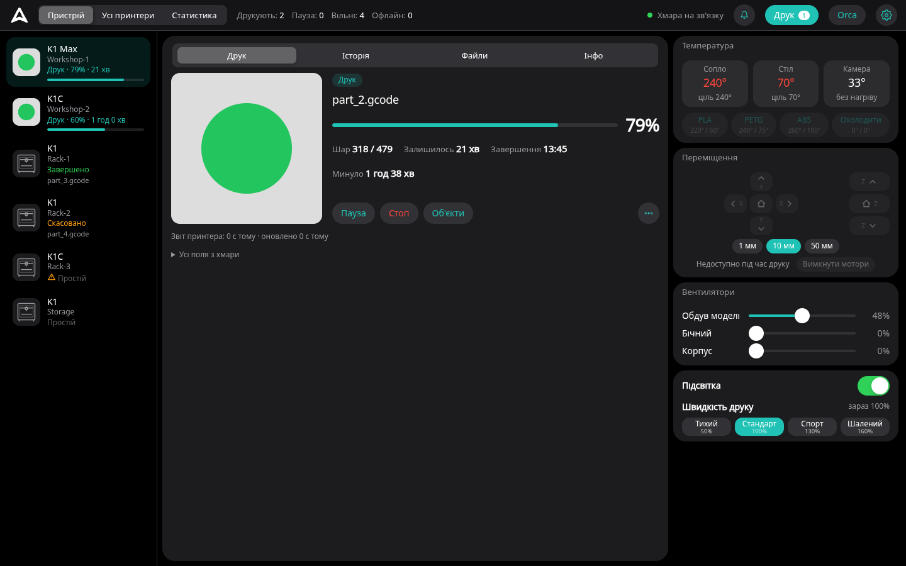
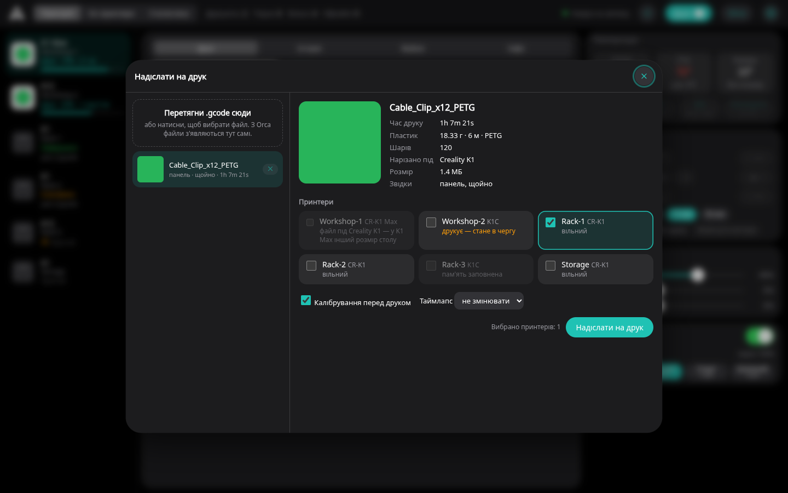
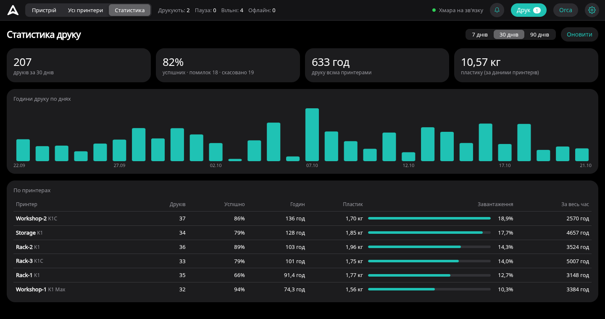
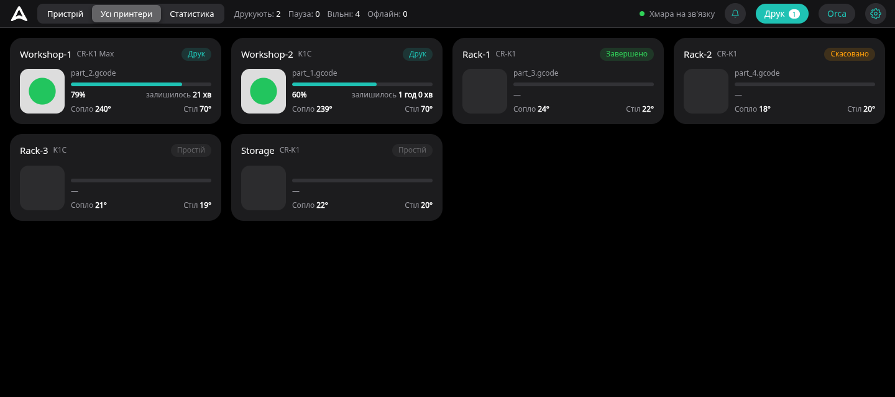
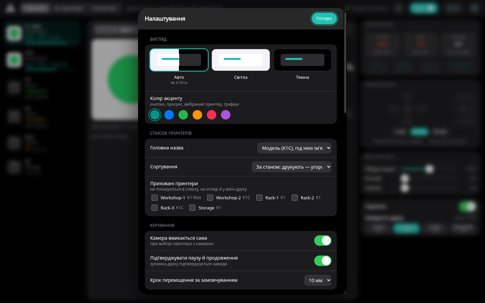

# Orca Creality Cloud

**Друк з OrcaSlicer на Creality K1 / K1C / K1 Max через Creality Cloud, без доступу до локальної мережі принтерів.**

[**Завантажити останню версію**](../../releases/latest)

---

## Що це

OrcaSlicer уміє надсилати файли на принтери Creality лише напряму, у локальній мережі. Якщо принтери в іншій мережі (інший поверх, цех, окрема VLAN),
лишається Creality Print з його хмарою.

**Orca Creality Cloud** дає Orca той самий хмарний канал: нарізаєш модель, натискаєш «Надіслати на друк» і файл іде на принтер через Creality Cloud.
А панель у браузері показує всі принтери акаунта одразу: стан, камеру, керування, чергу й статистику.

## Можливості

- **Друк з Orca:** принтер у списку Orca як звичайний «фізичний принтер», вікно надсилання з прев'ю, часом і вагою, вибір кількох принтерів, перевірка сумісності моделей.
- **Ферма принтерів:** черга на зайнятий принтер, повторний друк, статистика за 7 / 30 / 90 днів, огляд усіх принтерів.
- **Керування й камера:** пауза, стоп, температури з наборами підігріву, вентилятори, підсвітка, швидкість, переміщення осей, виключення окремої деталі, камера через хмару.
- **Зручність:** сповіщення Windows, світла й темна теми, майстер налаштування, що сам підключає профілі Orca, оновлення з панелі.

<table>
<tr>
<td width="50%">
Надсилання на кілька принтерів і в чергу
</td>
<td width="50%">
Статистика друку
</td>
</tr>
<tr>
<td>
Усі принтери
</td>
<td>
Налаштування й теми
</td>
</tr>
</table>

## Встановлення

| | |
|---|---|
| **Система** | Windows 10 або 11 |
| **Creality Print** | 7.x, з виконаним входом в акаунт, до якого прив'язані принтери |
| **OrcaSlicer** | 2.x з профілями Creality K1 / K1C / K1 Max |
| **Python** | 3.9 або новіший (майстер запропонує встановити сам) |

1. Завантаж `orca-creality-cloud-X.Y.Z.zip` з [останнього релізу](../../releases/latest) і розпакуй у постійну папку, наприклад `C:\OrcaCrealityCloud`.
2. Запусти `Майстер налаштування.bat`: він перевірить систему, запустить міст, увімкне автозапуск і пропише адресу та ключ у профілі принтерів Orca.
3. В Orca обери профіль принтера «… - Creality Cloud» і натискай «Надіслати на друк».

Панель відкривається за адресою `http://127.0.0.1:8765`.

## Оновлення

Коли виходить нова версія, у шапці панелі з'являється плашка «Оновлення». Натисни її й «Оновити й перезапустити»: міст завантажить архів з цього
репозиторію, перевірить контрольну суму SHA-256, замінить файли (попередні зберігаються в `data\update_backup`) і сам перезапуститься.
Твої налаштування, ключ і вхідні файли лежать у папці `data` і не змінюються. Перевірку можна вимкнути в ⚙ → «Оновлення».

Версії до 2.4.0 оновлюються вручну: заміни файли новим архівом (папку `data` не чіпай).

## Безпека й приватність

- Міст слухає лише `127.0.0.1`: з мережі він недоступний.
- Токен Creality із Creality Print не потрапляє в браузер і нікуди, крім серверів Creality, не передається.
- Команди на принтер надсилаються з білого списку з перевіркою меж; довільний G-code надіслати не можна.
- Окрім Creality, міст звертається лише до цього репозиторію на GitHub, щоб дізнатися про нові версії.

## Обмеження

- Телеметрія через хмару оновлюється раз на 2-6 с, а не миттєво, як у локальній мережі.
- Хмара не дозволяє запустити друк файлу, що лежить лише в пам'яті принтера, тільки файли, які вже проходили через хмару.
- Багатоколірний друк із CFS не підтримується.
- Аварійна зупинка йде через хмару й доходить за кілька секунд: справжній аварійний вимикач це кнопка живлення.
- Проєкт використовує недокументоване API Creality Cloud, яке може змінитися без попередження.

## Ліцензія

[GNU Affero General Public License v3.0](LICENSE). Історія змін описана в нотатках кожного [релізу](../../releases).

> Неофіційний проєкт, не пов'язаний із Creality чи командою OrcaSlicer. Creality, K1 і Creality Cloud це торговельні марки їхніх власників.
